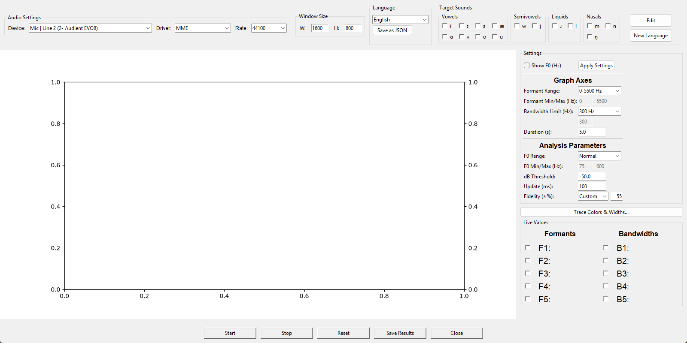

# formants_mak — Real-Time Formants and Bandwidths for Visual Biofeedback

[](https://doi.org/10.5281/zenodo.24051498)
[](LICENSE)

**Keywords:** formants, formant tracking, bandwidths, LPC, Burg method,
visual biofeedback, voice therapy, speech therapy, articulation, vowels,
phonetics, acoustic analysis, speech analysis, speech-language pathology,
signal processing, language education, Turkish, Praat, parselmouth, real-time

> **Part of the Sonus et Vox suite.** formants_mak is one of four
> real-time voice biofeedback modules built on the author's Distributed
> Tissue Vibration (DTV) framework for voice production (Kılıç, 2026; see
> References). formants_mak is released here as a **free, open-source
> academic application** for research and teaching (GPL-3.0); it is not
> sold and has no license key or paid edition. The other three modules are commercial
> applications available from the
> [Sonus et Vox store on Lemon Squeezy](https://sonusetvox.lemonsqueezy.com/):
>
> - **rtime_mak** — real-time voice quality graphics (jitter, shimmer, pitch, intensity)
> - **resonance_mak** — real-time nasal/oral or buccal/laryngeal energy ratio
> - **harmonicity_mak** — real-time harmonicity (HNR) and cepstral peak (CPP/CPPS) graphics
>
> The commercial modules are standalone applications written in Rust;
> they do not run on Python and do not call Praat or parselmouth.

formants_mak captures a single microphone input and tracks the first five
vocal-tract formants (F1–F5) and their bandwidths in real time, plotted as
a scrolling graph for visual biofeedback — useful for articulation therapy,
vowel-quality training, and general voice/speech analysis.



## How it works

Incoming audio is rolled into a ~0.5s buffer and analyzed with Praat's Burg
LPC method (via [parselmouth](https://parselmouth.readthedocs.io/)) on every
audio block, alongside a pitch (F0) estimate from a self-contained YIN
implementation (`YinPitchDetector` in formants_mak.py — no external pitch
library). F0 gates formant detection to voiced speech, and also lets the
app reject a raw formant candidate that's really just F0 bleeding through
as a spurious low-frequency LPC root — the most common cause of F0/F1
confusion.

Because Burg's per-frame formant numbering can misassign a formant to the
wrong slot (e.g. a spurious low peak can bump every later formant up one),
each raw candidate is re-matched against a set of **expected** formant
frequencies — see **Target Sounds** below — within a configurable
**Fidelity** band (how far a candidate may drift from its expected value
and still be accepted). This matching/fidelity approach is an original
technique built for this app, not derived from a published method.

## Language (phoneme inventory)

The Target Sounds bar shows the phoneme inventory of the selected
**Language** (top bar). The list contains the built-in **Turkish** and
**English** presets (embedded in the program, so they
need no file), every language `.json` file found next to the app
(listed as "<name> (json)", the name being the file's `language` field) and
**External JSON...**. Every language added later is file-based, so it always
carries the "(json)" mark.

- **New Language** (button under **Edit** in Target Sounds) is the one place
  to add a language. It opens a small window with two steps:
  **Create Blank Form** writes `new_language.xlsx` next to the app and opens
  it (if the file already exists it is left alone and you are told so). Fill
  in the language name (cell B1) and, per category — Vowels (up to 8),
  Semivowels, Liquids, Nasals (up to 4 each; numbered rows) — the IPA symbol
  of each sound with its F1 and F2 in Hz; F3–F5 are optional and, when left
  empty, get a typical value for that category (the mean of the built-in
  Turkish and English sounds of the same category). Save the form, then
  **Read Form** creates `<name in lower case>.json` (e.g. "German" →
  `german.json`), selects it and lists it under Language. Only rows with
  IPA, F1 and F2 all filled in are added; every other used row (a missing
  cell, a non-numeric value, a duplicate symbol, a row over the category
  limit) is skipped and listed, with its row number, in the message shown
  afterwards, together with the F3–F5 values that were filled in. An
  existing `<name>.json` is never overwritten. Use **Edit** afterwards to
  adjust the new language.
- A file-based language can be edited both in the app (**Edit** writes the
  changes back to its file) and directly in the file: **Open file** opens it
  in your default editor, and the app re-reads the file automatically within
  a couple of seconds whenever it changes on disk (**Reload** forces it).
- **Turkish and English can be edited too.** If `turkish.json` /
  `english.json` exists next to the app, the built-in entry loads that file
  instead of the embedded values and is listed as "Turkish (json)" /
  "English (json)"; without the file it uses the embedded values and is
  listed plainly. **Save as JSON** creates the file from the embedded values
  (so does the first **Edit → Apply** on a built-in language); from then on
  edit it by hand (**Open file**) or with **Edit**. Delete the file to return
  to the built-in values. The embedded presets themselves never change.
- **External JSON...** loads a language file from any folder.
- Any change made in the Edit dialog is written back to the active language
  file.

File format:

```json
{"language": "Turkish",
 "phonemes": {"Vowels": ["a", "e"], "Semivowels": [], "Liquids": [], "Nasals": []},
 "phoneme_formants": {"a": [750, 1300, 2600, 3300, 4200], "e": [500, 2100, 2700, 3400, 4300]}}
```

## Target Sounds

The top bar lets you pick a target speech sound (Vowels / Semivowels /
Liquids / Nasals) — selecting one loads that sound's expected
F1–F5 values, used for the matching described above. **Edit** opens the
selected language's sound table, laid out like the New Language form: per
category a fixed set of numbered rows (8 vowels, 4 of everything else)
with IPA and F1–F5 cells. Type into an empty row to add a sound, clear the
IPA cell to remove one; empty rows are ignored, rows missing IPA, F1 or F2
are skipped and listed after Apply, and empty F3–F5 get the category's
typical values. Apply writes the table to the language JSON file (see
Language above). The **Fidelity** setting lives in the Settings panel.

## Microphone

**A note on measurement.** In biofeedback, what matters is not an absolute
value but a comparison: either the energy picked up by two microphones is
compared with each other, or the values of the sounds and speech a person
produces at different moments are compared with one another. Absolute
calibration, standardized equipment, and validity/reliability studies of
the microphone are therefore not required. formants_mak is a software tool
for training and biofeedback, not a medical device — it is non-invasive
and makes no diagnostic claim — so questions about CE marking or FDA
approval do not apply to it.

### Choosing a microphone

Because you compare your own voice with your own voice, from moment to
moment and from session to session, there is no need for a calibrated,
laboratory-grade setup. Pick something reasonable and then keep it — the
same microphone, at roughly the same distance, in the same room.
Consistency matters far more than price. (For research or formal analysis
you should be more careful: use a good-quality microphone and keep the
recording conditions fixed.)

Either a **dynamic microphone** or a **contact microphone** will do.

**Dynamic microphones.** Choose a **unidirectional** (cardioid) model: it
picks up the voice in front of it and rejects most room noise. Two
convenient ways to connect one:

- A **USB dynamic microphone** such as the **RØDE PodMic USB** or the
  **Samson Q9U** — plug it in and it appears as an input device, with
  nothing else to configure.
- Better still, a **handheld dynamic microphone** such as the **Shure
  SM58**, connected through a small USB audio interface such as the
  **Shure MVX2U** or the **Audient EVO 4**.

Much cheaper dynamic microphones also work perfectly well for biofeedback.

**Contact microphones (contact pickups).** These sense tissue vibration
directly rather than airborne sound, so room noise is largely irrelevant.
Professional XLR models such as the **AKG C411 PP** or the **Cortado Xe**
are one option; much cheaper disc-type passive piezo transducers (e.g. the
**Adeline AD-35**) also work. Bear in mind that passive piezo transducers
deliver a low signal level and tend to produce a high noise floor. When
connecting one to an interface such as the EVO 4, plug its TS jack straight
into the **instrument (D.I.) input**, not the microphone input.

## Installation (running from source)

Requirements: Python 3.11 (3.10+ should work) and a microphone. See
[installation.txt](installation.txt) for details. Quick start with conda:

```bash
conda env create -f environment.yml
conda activate formants_mak
python formants_mak.py
```

or with pip:

```bash
python -m pip install -r requirements.txt
python formants_mak.py
```

On Linux/macOS, `./formants_mak.sh` runs the app inside the conda env.
`python formants_mak.py --selftest` checks that all dependencies load and
writes the result to `selftest_result.txt` (or to the path in the
`FORMANTS_MAK_SELFTEST_OUT` environment variable).

Note: the PyPI package is `praat-parselmouth` (imported as `parselmouth`);
do **not** `pip install parselmouth`, which is an unrelated package.

## Usage / UI overview

On launch, choose the input device, sample rate, and window size under
**Audio Settings** / **Window Size**, optionally pick a **Target Sound**,
and press **Start**.

- Check any of the **Formants** / **Bandwidths** boxes in **Live Values**
  to plot that trace and show its live reading — unchecked ones stay
  blank.
- **Show F0 (Hz)** overlays the current pitch estimate as red text on the
  graph.
- **Reset** clears the graph and recorded data without closing the app.
- **Save Results** exports the recorded Time / F1–F5 / B1–B5 / F0 values
  to a CSV file.
- **Close** stops the audio stream, saves the current settings, and exits.
- **Trace Colors & Widths...** customizes each F/B line's color and
  thickness.

## Settings reference

| Setting | Description |
|---|---|
| Audio Settings (Device / Driver / Rate) | Selects the input device, host API, and sample rate used for the stream. |
| Window Size (W / H) | Live-resizes the application window. |
| Language | Turkish / English built-in inventories (a `turkish.json` / `english.json` next to the app takes priority and shows as "<name> (json)"), other language .json files next to the app shown as "<name> (json)", External JSON...; "Save as JSON" creates `<language>.json`; for a file-based language "Open file" / "Reload" (the file is also re-read automatically when it changes on disk). |
| Target Sounds | Pick a speech sound to auto-fill expected F1–F5; "Edit" edits the selected language's symbol/target list (saved to its JSON); "New Language" creates a language from the `new_language.xlsx` form (Create Blank Form / Read Form). |
| Show F0 (Hz) | Overlays the current pitch estimate on the graph (red text, top-left). |
| Formant Min/Max, Bandwidth Limit (Graph Axes) | Y-axis bounds; each has quick presets plus a "User Specified"/"Custom" option. |
| Duration (s) | Width of the scrolling time window shown on the X-axis. |
| F0 Min/Max | Pitch range used to gate formant detection to voiced speech; Normal/High/Custom presets. |
| dB Threshold | Noise gate: below this RMS level, no formants/F0 are computed for that block. |
| Update (ms) | How often the graph and readouts refresh. |
| Fidelity / Deviation (±%) | How closely a reading must match its expected value to be accepted — Strict (±30%) / Normal (±45%) / Loose (±60%) / Custom with your own ±%. Applied with "Apply Settings". |

## Citing formants_mak

If you use formants_mak in research, please cite it using the metadata in
[CITATION.cff](CITATION.cff) (GitHub's "Cite this repository" button) or
the Zenodo DOI above.

## License

formants_mak is free software, released under the
[GNU General Public License v3.0](LICENSE) (GPL-3.0-only). It uses
[Praat](https://www.fon.hum.uva.nl/praat/) through
[parselmouth](https://parselmouth.readthedocs.io/) (both GPL-3.0).

The other Sonus et Vox modules (rtime_mak, resonance_mak, harmonicity_mak)
are standalone Rust applications; they are not part of this repository
and are not covered by this license.

## Support

For questions or issues about the app, contact **makilic@yahoo.com**.

## References

- Boersma, P., & Weenink, D. (2021). *Praat: Doing phonetics by computer*
  (Version 6.1.38) [Computer program]. https://www.praat.org/ (the Praat
  version bundled with parselmouth 0.4.7; used for Burg LPC formant analysis)
- de Cheveigné, A., & Kawahara, H. (2002). YIN, a fundamental frequency
  estimator for speech and music. *Journal of the Acoustical Society of
  America*, 111(4), 1917–1930. https://doi.org/10.1121/1.1458024 (F0 gate)
- Hillenbrand, J., Getty, L. A., Clark, M. J., & Wheeler, K. (1995). Acoustic
  characteristics of American English vowels. *Journal of the Acoustical
  Society of America*, 97(5), 3099–3111. https://doi.org/10.1121/1.411872
  (source of the English preset's F1–F3)
- Jadoul, Y., Thompson, B., & de Boer, B. (2018). Introducing Parselmouth: A
  Python interface to Praat. *Journal of Phonetics*, 71, 1–15.
  https://doi.org/10.1016/j.wocn.2018.07.001
- Kılıç, M. A. (2026). From acoustic resonance to flow-induced distributed
  tissue vibration: An aero-elasto-dynamic theoretical framework for voice
  and speech production. *Praxis of Otorhinolaryngology*, 14(3), 186–202.
  https://doi.org/10.5606/kbbu.2026.25 (open access)
